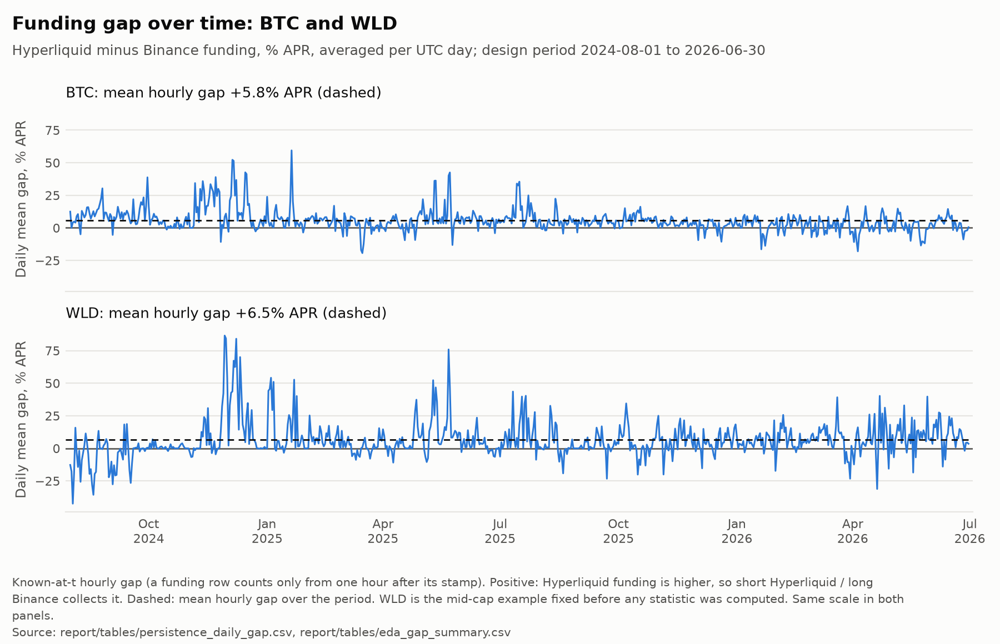
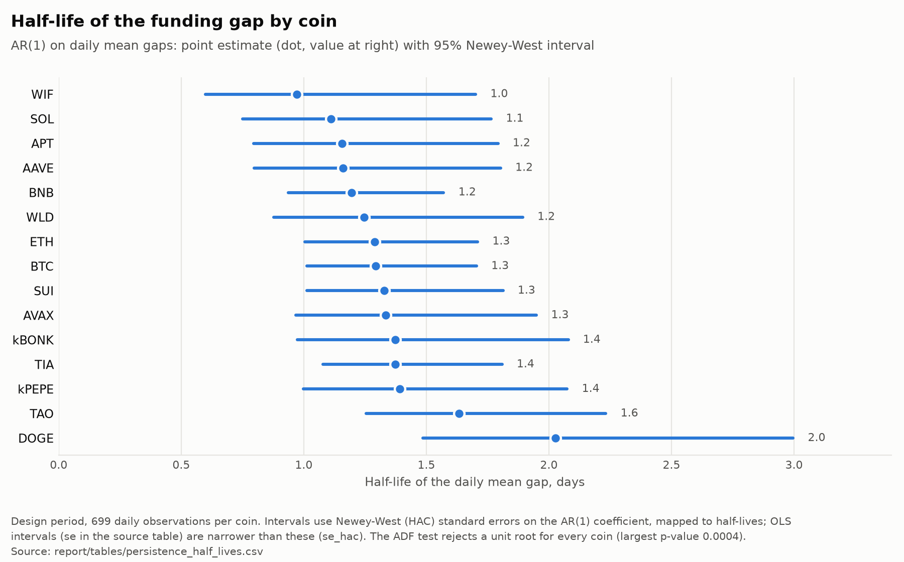
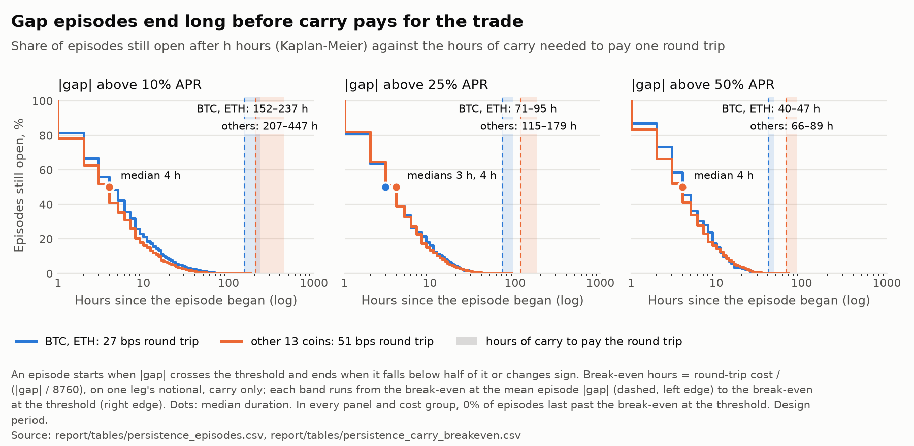
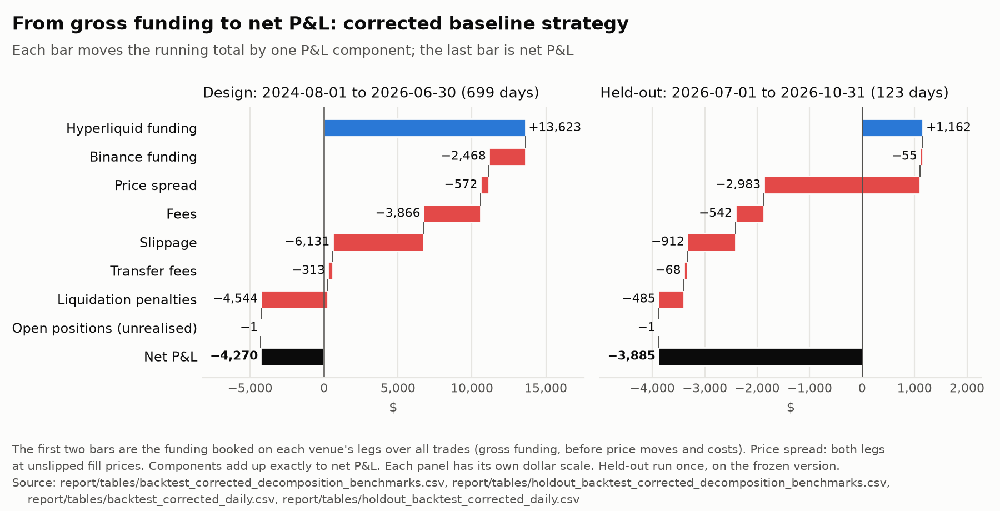
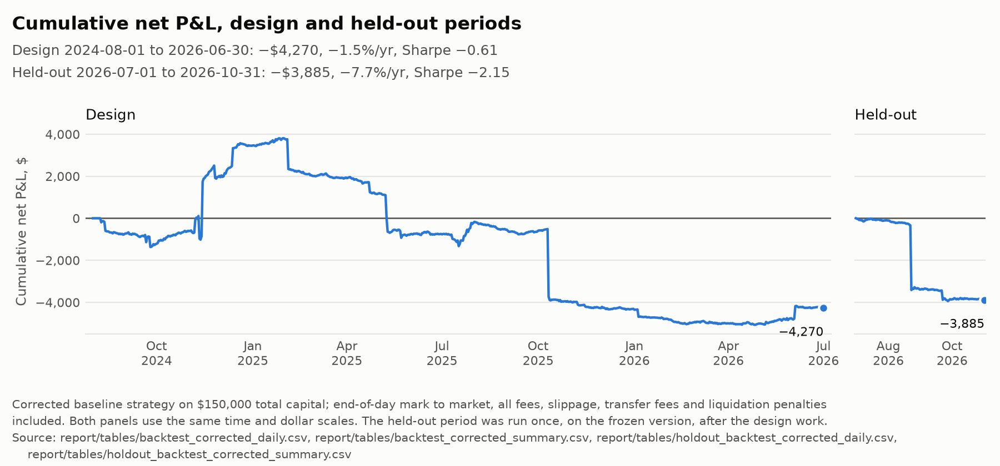
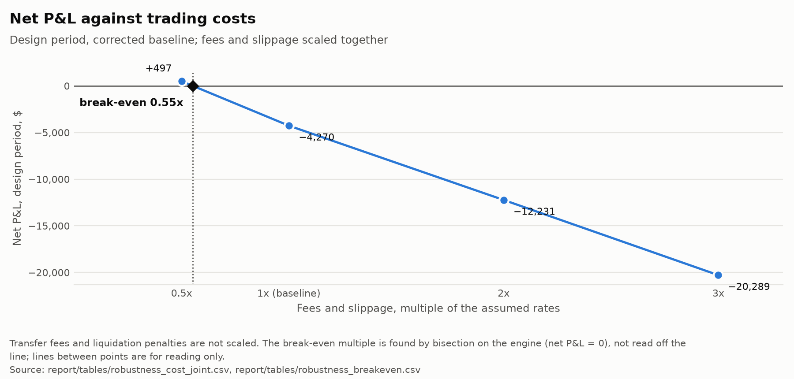
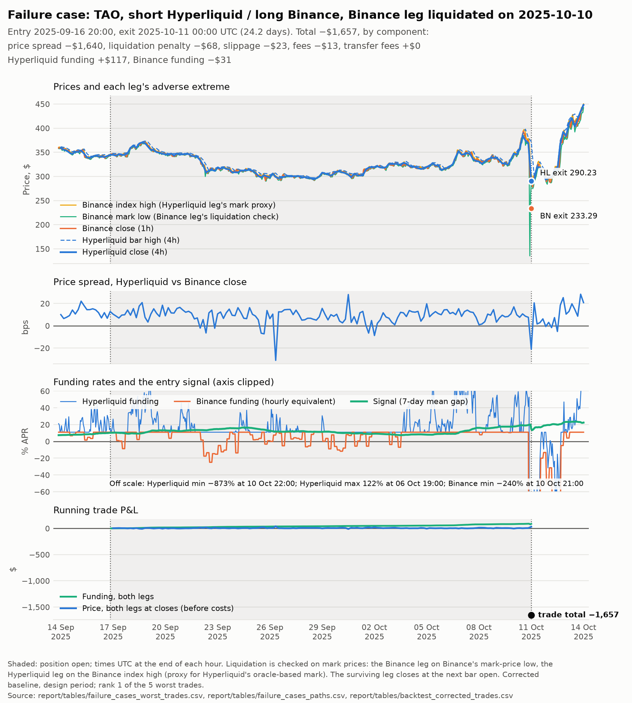
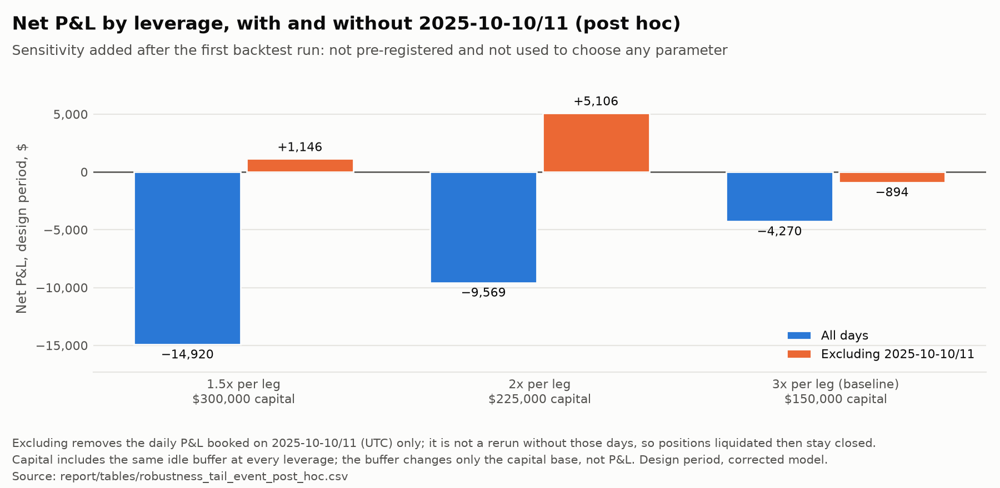

# Funding-rate dislocations between Hyperliquid and Binance

## 1. Summary

When the same coin's funding rate differs between Hyperliquid and Binance, a trader can
short the perp where funding is higher and go long where it is lower: price moves cancel
out, and the position collects the difference in funding. This project studies whether those
gaps are large and persistent enough for that hedged position to make money after all
costs. The following four hypotheses were set out before the analysis:

- **H1:** the funding gap mean-reverts, with a measurable half-life (supported).
- **H2:** gaps are larger in volatile, trending markets and in smaller coins (consistent
  with the regime associations, which are not causal).
- **H3:** a threshold rule on the gap earns positive net carry after realistic costs on
  the held-out period (not supported; Section 6).
- **H4:** any edge is smaller in large, liquid coins (not supported: the majors broke even
  while the other coins lost, though the uncertainty of that difference was not
  estimated).

Over the design period (1 August 2024 to 30 June 2026), Hyperliquid
funding was higher than Binance's on average for all 15 coins, by 3.1% to 10.9% APR, and
the daily gap reverts to its average with a half-life of one to two days. Individual
spikes, however, close within a median 3 to 4 hours: far too fast to pay for a round trip
of 27 to 51 bps.

A slower strategy that trades only the persistent part of the gap, entering when its
7-day average exceeds 10% APR, does collect the carry: +$11,156 in net funding. But fees
and slippage (-$9,997) and liquidation penalties (-$4,544) take more than all of it, and
it loses $4,270 on $150,000 of capital (-1.5% a year). It would only break even if
trading costs were about 45% lower.

On a held-out period run once on frozen code (1 July to 31 October 2026), it loses
$3,885, mostly on two positions liquidated on the same day. With only 28 trades, that
period is too short to judge the strategy's timing, but it confirms the main result: the
funding gap exists, but at retail-tier costs, and with the liquidation risk of a hedge
split across two venues, it cannot be harvested.

## 2. Mechanics

Both venues charge funding as an average premium of the perp over its reference price plus a clamped interest term, `clamp(interest - premium, ±0.05%)`, with interest at 0.01% per 8 hours. When the premium sits inside the clamp, funding rests at the interest rate: 10.95% APR paid by longs to shorts.

|  | Hyperliquid | Binance USDⓈ-M |
| --- | --- | --- |
| Settlement | Hourly, 1/8 of the 8-hour rate | 8-hourly by default (4-hourly for 4 of our symbols); can change |
| Payment notional | Size × oracle price | Size × mark price |
| Cap | 4% per hour | Per-symbol caps and floors |
| Interest component | 0.01% per 8 h | 0.01% per 8 h by default, scaled to the interval; 0 for BNBUSDT |
| Margin asset | USDC | USDT |

Rates are converted to one hourly basis before comparison. A Hyperliquid position earns funding every hour, a Binance position only if open at settlement, and a hedge also gains or loses on the cross-venue price spread. Potential reasons for persistent gaps include different trader populations, different settlement clocks, the collateral and transfers needed on both venues, and the clamp and caps binding at different levels. This study does not test them, although the regime associations (larger gaps with BTC volatility, large 30-day moves and high market-wide funding) are consistent with the first two. Hyperliquid sits at its 10.95% APR resting rate in more hours than Binance for 14 of 15 coins (39–73% against 18–53%); for BNB, Binance rests more often (65% of hours) but at zero, which gives a +10.95% APR mechanical gap.

## 3. Data

### 3.1 Sources

All sources used are public endpoints: Hyperliquid funding and candles; Binance funding, 1h trade, mark-price and index-price klines, and snapshots of symbol metadata. Hyperliquid serves only its latest 5,000 candles, so its hourly prices start on 2026-04-09; earlier prices are 4h.

### 3.2 Universe

The universe is fixed in advance, before the funding analysis: 4h Hyperliquid candles from 2024-08-01, a Binance USDT perp trading by then and still trading, and the top 15 by Hyperliquid USD volume over August–October 2024, BTC, ETH and SOL always included. Result: BTC, ETH, SOL, kPEPE, SUI, WIF, TIA, DOGE, WLD, AAVE, APT, kBONK, AVAX, TAO, BNB (POPCAT, rank 8, listed on Binance only on 2024-08-22, so BNB, rank 16, entered).

### 3.3 Sample split

The split was locked at the start, and the held-out period was run once, after the `v1-frozen` tag:

| Period | Dates (UTC, inclusive) | Use |
| --- | --- | --- |
| Design | 2024-08-01 to 2026-06-30 (699 days) | Exploration, strategy design, robustness |
| Held-out | 2026-07-01 to 2026-10-31 (123 days) | One run, on the frozen model |

### 3.4 Cleaning and key decisions

The full reasoning is in the [decision log](decisions.md) (2026-11-04), with detail in Appendix A. All data sit on one hourly UTC grid, with Binance settlement intervals inferred from the spacing between settlements. A Hyperliquid funding row stamped T is the funding for \[T−1h, T), and on both venues a signal uses a row stamped T only from T+1h, so publication delay cannot leak into a decision. One missing Hyperliquid hour and one missing Binance settlement (four 4h symbols) book zero funding. Binance's interest rate for BNBUSDT is zero, so BNB has a mechanical gap of +10.95% APR; trading uses the raw gap because that part is real carry.

## 4. Findings (design period)

### 4.1 Gap size

The mean gap is positive for every coin, from 3.1% APR (APT) to 10.9% (TAO). Hour by hour it is large: |gap| exceeds 10% APR in 28–60% of hours and 50% APR in 1.3–8.6%. The monthly mean is positive in 61–100% of the 23 months, yet the slow part (trailing 30-day mean) explains only 3–19% of the variance.

### 4.2 Persistence

An AR(1) on daily mean gaps gives phi of 0.49 (WIF) to 0.71 (DOGE): half-lives of 0.97 to 2.03 days, with 95% Newey-West intervals spanning 0.60 to 3.00 days. A Dickey-Fuller test rejects a unit root for every coin (largest p-value 0.00036), and rolling 90-day fits give median half-lives of 0.74 to 1.35 days. H1 (mean reversion with a measurable half-life) is supported, though a daily model cannot see reversion faster than a day.

 

*Figure 1 (left). Daily mean gap, Hyperliquid minus Binance, for BTC and the mid-cap example WLD (chosen before the statistics); means: BTC 5.8% APR, WLD 6.5% APR. Figure 2 (right). Half-life of the daily mean gap by coin, with 95% Newey-West intervals.*

### 4.3 Episode durations against break-even

An episode starts when |gap| crosses a threshold and ends when it falls below half the threshold or changes sign. Break-even is the hours of carry at a given |gap| needed to pay one round trip (four taker fills, fees plus slippage).

| Threshold | Coins (round trip) | Episodes | Median / p80 duration (h) | Break-even at threshold (h) | at mean episode gap (h) | Share past break-even |
| --- | --- | --- | --- | --- | --- | --- |
| 10% APR | BTC, ETH (27 bps) | 1,628 | 4 / 11 | 236.5 | 152.3 | 0 |
| 10% APR | other 13 (51 bps) | 16,603 | 4 / 9 | 446.8 | 206.9 | 0 |
| 25% APR | BTC, ETH | 447 | 3 / 9 | 94.6 | 70.9 | 0 |
| 25% APR | other 13 | 7,377 | 4 / 8 | 178.7 | 115.1 | 0 |
| 50% APR | BTC, ETH | 138 | 4 / 9 | 47.3 | 40.5 | 0 |
| 50% APR | other 13 | 2,607 | 4 / 8 | 89.4 | 65.5 | 0 |

Episodes last hours, while break-even takes days to weeks: no episode, at any threshold, lasted long enough for its carry to pay a round trip. This counts funding carry only, ignoring price-spread moves and Binance’s settlement timing, and it is a cost-feasibility argument rather than a backtest of an episode-trading rule.

*Figure 3. Share of episodes still open after h hours (Kaplan-Meier) by threshold, against the break-even band: from the break-even at the mean episode gap (dashed) to that at the threshold.*

### 4.4 Regimes

Regressing daily mean |gap| on regressors known at the start of the day (coin fixed effects, Driscoll-Kraay errors), |gap| rises per standard deviation of previous-day BTC volatility by 1.7 points of APR, of 30-day |return| by 2.4, of 30-day return by 2.1 and of previous-day market-wide funding by 3.3 (all p \< 0.01); volume has no effect (p = 0.96), and large caps sit 2.1 points lower in a pooled version. H2 (larger gaps in volatile, trending markets and smaller coins) is consistent with these associations, which are not causal. Gaps co-move (average correlation 0.23 hourly, 0.40 daily), so the 15 coins act like about 3.5 or 2.3 independent ones.

### 4.5 Gap and price spread

The price spread correlates with the realised gap at 0.42–0.54 for BTC, ETH and SOL, near zero for WIF (-0.05) and kBONK (0.06). During gap episodes in the 82-day hourly-price window the price spread moved a median +0.3 to +0.8 bps in the position's favour (10th–90th percentile about -7 to +9 bps at 10%), and more than 10 bps against in 6–7% of episodes, against round trips of 27–51 bps; over the strategy's multi-week holds the price spread caused its largest losses (held-out -$2,983; -$764 to -$1,640 in each of the five worst design trades).

## 5. Strategy

### 5.1 Choosing the signal

The exploratory analysis showed that short episodes cannot pay their costs and that the persistent component is the tradable part ([decision log](decisions.md), 2026-11-04), so an initial rule (a 20% APR gap held for 3 hours) was replaced by a slow signal meant to hold for weeks. It was fixed in writing before any backtest existed, and the backtest parameters before the engine was built.

| Rule | Baseline |
| --- | --- |
| Signal | Trailing 7-day mean of the known-at-t gap per coin (168 hourly rows, all required) |
| Entry | \|signal\| > 10% APR: short the venue with higher funding, long the other |
| Exit | \|signal\| \< 3% APR or a sign change; spread stop at 100 bps adverse; no maximum hold, no regime filters |
| Re-arm | After a stop or forced close, no re-entry until the signal meets the exit rule (decided before the first backtest) |
| Sizing | $10,000 per leg, same coin quantity on both legs; one position per coin, up to 15 |
| Clock and fills | Decide every 4 h until hourly Hyperliquid candles start (2026-04-09), then hourly; both legs fill at the next bar's open |
| Funding | Hyperliquid every hour held, Binance at settlements while open; Binance 1h closes proxy the mark and oracle prices |

### 5.2 Costs and margin

All cost and margin parameters are set in `config.yaml`. Taker fees of 4.5 bps (Hyperliquid) and 5.0 bps (Binance) plus slippage of 2 bps (BTC, ETH) or 8 bps (others) per fill: a four-fill round trip costs 27 or 51 bps of one leg's notional. Each leg runs at 3x ($3,333 initial margin), with maintenance margins per venue and coin from 2026-11-08 snapshots (Hyperliquid 1.25–10%, Binance 0.4–1.25%). A leg is liquidated when its equity at the bar's adverse price extreme reaches maintenance; it closes 100 bps worse than its liquidation price and the other leg closes at the next bar open. Below 50% of its margin requirement, a leg receives half the equity difference from the other ($1 fee, 2-hour delay). Capital is $150,000 (margin on both venues plus a 50% buffer), and returns are on total capital.

### 5.3 Model corrections

The first run lost $8,871. Two parts of the model did not match how the venues work, so I corrected them before seeing the effect: liquidations are now checked on mark prices rather than last trades, and the rebalance trigger follows the current margin requirement rather than the initial one. The corrected model, which loses $4,270 with 38 liquidations instead of 45, is the baseline and was fixed for the held-out run beforehand.

## 6. Results

### 6.1 Baseline

| Corrected baseline, $150,000 capital | Design (699 days) | Held-out (123 days) |
| --- | --- | --- |
| Net P&L | -$4,270 | -$3,885 |
| Annualised return on total / deployed capital | -1.5% / -6.6% | -7.7% / -50.6% |
| Sharpe (daily, ×√365) | -0.61 | -2.15 |
| Maximum drawdown | -$8,881 (-5.8%) | -$3,928 (-2.6%) |
| Closed trades / hit rate / average hold | 213 (+1 open) / 35% / 16.3 days | 28 (+2 open) / 18% / 13.2 days |
| Worst trade | -$1,657 (TAO) | -$2,028 (WLD) |
| Liquidations / rebalances / spread stops | 38 / 313 / 0 | 4 / 68 / 0 |

The held-out loss over 123 days (-$3,885) is close to the design loss over 699 days (-$4,270); no confidence interval was computed for the held-out period. BTC, ETH and SOL never traded in the held-out period. Two trades liquidated at 2026-08-22 06:00 UTC lose $3,149: WLD -$2,028 and TIA -$1,121, mostly price spread (-$1,918 and -$967). Both lost a long leg in a one-hour fall of 22–26% on both venues after a rally, holding negative collateral after rebalances that neither venue's withdrawal rules allow at 3x leverage (Appendix C.2). With transfers capped at the venues' documented limits (a post-hoc sensitivity, Section 7.3 and Appendix E), neither WLD nor TIA is liquidated on 2026-08-22 and the held-out loss is -$950; the frozen result above remains the headline.

| P&L component | Design | Held-out |
| --- | --- | --- |
| Hyperliquid funding | +$13,623 | +$1,162 |
| Binance funding | -$2,468 | -$55 |
| Price spread | -$572 | -$2,983 |
| Fees | -$3,866 | -$542 |
| Slippage | -$6,131 | -$912 |
| Transfer fees | -$313 | -$68 |
| Liquidation penalty | -$4,544 | -$485 |
| Unrealised price (open at end) | -$0.6 | -$0.8 |
| **Net** | **-$4,270** | **-$3,885** |

In the design period the carry works (+$11,156 of funding net of the Binance leg), but fees and slippage (-$9,997) take almost all of it and liquidation penalties the rest. In the held-out period funding is small (+$1,108 net) and the price spread on the two liquidated trades drives the loss.

*Figure 4. P&L from funding to net by component, design and held-out (separate dollar scales).*

### 6.2 Benchmarks

All benchmarks use the same engine and costs. Random entry keeps each coin's number of trades, holding periods and sides, but enters at random times:

|  | Design | Held-out |
| --- | --- | --- |
| Strategy | -$4,270 | -$3,885 |
| Zero cost (same trades, no fees or slippage) | +$5,686 | -$1,761 |
| Always-on (short Hyperliquid / long Binance, every coin) | -$17,037 | -$15 |
| Random entry, mean of 200 seeds (5th–95th percentile) | -$11,436 (-$17,098 to -$5,684) | -$1,283 (-$3,154 to -$391) |
| Random-entry seeds below the strategy | 99% | 3% |

In the design period the strategy's timing beats random timing and picks up carry before costs. Always-on loses most, mainly on the price spread (-$25,753). In the held-out period the ranking reverses: the strategy falls below the random 5th percentile and loses even at zero cost, while always-on loses only $15. It still collected more net funding than the random-entry mean (+$1,108 against +$873); the shortfall comes from the price spread on two liquidated trades. Over the Binance hack window (2026-10-29 to 31), reported separately, as decided before the run, the strategy made -$9, the zero-cost run +$44 and always-on +$139, with no liquidations in any of them; the strategy made 2 collateral transfers and always-on 8. Without those days the strategy loses $3,875 (Sharpe -2.17).

*Figure 5. Cumulative net P&L, design and held-out. Panel widths are proportional to each period's length; the dollar scale is shared.*

## 7. Robustness (summary)

All checks use the design period and corrected model, were specified before running, and never changed the baseline ([decision log](decisions.md), 2026-11-08). **Post hoc** marks items added after the first backtest run. Full tables are in Appendix B (costs, grid, coin and time splits), C (failure cases), D (post-hoc maker, leverage, buffer and tail-event sensitivities) and E (transfer cap).

### 7.1 Configurations tried

No backtest ran before the signal and parameters were fixed. On the design period **111 strategy configurations** were run: the baseline in 2 model variants (each with zero-cost, always-on and 200 random-entry runs), 108 robustness configurations (cost 23, including 7 bisection steps; maker 1; parameter grid 59; universe subsets 17; leverage × buffer 8, giving two new P&Ls) and, after the held-out run, the post-hoc transfer cap (1, with the same benchmarks). The held-out period was run **once** on the frozen model, with the same benchmarks; the transfer cap was later run on it as a sensitivity, after the period had been used.

### 7.2 Main checks

- **Costs:** net P&L is +$497 with fees and slippage at 0.5x and -$12,231 at 2x; the break-even cost multiple is **0.55x** (Appendix B.1, Figure 6).
- **Bootstrap:** a 7-day block bootstrap gives a 95% Sharpe interval of **-1.88 to +0.84** (20% of resamples above zero), so the design period alone cannot separate a small edge from a loss.
- **Grid and splits:** 21 of 60 parameter cells are positive, with no plateau; 6 of 15 coins and 3 of 8 quarters are positive (Appendix B.2–B.3).
- **Failure cases:** the five worst design trades were all liquidations; four of them on 2025-10-10, whose losses depend on the 4h bar mechanic (Appendix C.1, Figure 7).
- **Post-hoc sensitivities:** maker fills on both legs give +$973, an optimistic case; lower leverage loses more (-$14,920 at 1.5x) because of liquidations on 2025-10-10/11 (Appendix D, Figure 8).

### 7.3 Transfer cap (post hoc)

Capping each rebalance at what the venues' documentation allows (Binance: no more than the wallet balance, which excludes unrealised profit; Hyperliquid: unrealised P&L only while the initial margin remains) changes the held-out loss from -$3,885 to -$950, as WLD and TIA survive 2026-08-22, but the design loss from -$4,270 to -$7,756, through costlier short-Hyperliquid liquidations; neither period becomes profitable. It was added after the held-out run, so it is a sensitivity, not a test (Appendix E).

## 8. Limitations and next steps

### 8.1 Known limitations

From the [limitations log](limitations.md), which also gives the fixes:

| Limitation | Likely bias |
| --- | --- |
| **Data and measurement** |  |
| Survivorship: one delisted coin (FTM) would have made the universe | Not measured; direction unknown |
| 4h Hyperliquid prices before 2026-04-09 (4-hourly decisions and stops) | Understates design spread risk; flatters design against held-out |
| Last-trade closes for the spread and funding notional; USDC = USDT | Noise; understates risk in a depeg |
| Caps, interest rates, margins from 2026 snapshots; missing hour and settlement | Small or negligible |
| **Execution and risk model** |  |
| Surviving leg closes at the next bar open after a liquidation: on 4h bars the liquidated leg closes at the low and the hedge up to 4 h later (Appendix C.1) | Likely overstates the 2025-10-10 tail-event losses and any loss after a wick that rebounds; makes low leverage look worse |
| Hourly mark extremes in 4h bars; fixed 100 bps penalty | Slightly overstates liquidations; penalty may understate a gap-through |
| Hyperliquid mark proxied by the Binance spot index | Probably understates Hyperliquid liquidations |
| No resizing; idle buffer; flat slippage; maker fills assumed | Understates stress costs; overstates maker scenario |
| Rebalancing ignores the venues' withdrawal limits and can move a leg's unrealised gains (both 2026-08-22 liquidations; Appendix E) | Mixed (post-hoc transfer cap): overstates the held-out loss (-$3,885 frozen against -$950 capped) and understates the design loss (-$4,270 against -$7,756) |
| **Statistics and sample** |  |
| Daily AR(1) half-life; episode rule ends at half the threshold | Overstates precision; shortens measured episodes |
| Spread during episodes from the 82-day hourly window only | Understates adverse moves in stress |
| Robustness reuses the design period; gaps co-move | Overstates confidence either way |
| Held-out is short: 123 days, 28 closed trades | One day (2026-08-22) can dominate |

### 8.2 Venue and counterparty risk

The backtest assumes both venues stay open, transfers arrive in 2 hours and balances are safe. The Binance hack of 29–31 October 2026 falls inside the held-out window: the strategy made 2 collateral transfers and always-on 8 during it, so a withdrawal halt would have blocked rebalancing, and the model does not represent a halt or a loss of funds held on a venue. This understates risk, possibly by a lot; the -$9 to +$139 measured in that window is not what the hack would have cost.

### 8.3 Next steps

1. Close the surviving leg at the liquidation time with hourly Hyperliquid prices.
2. Buy historical 1h Hyperliquid candles and log its mark and oracle prices live.
3. Model venue states (paused withdrawals, delayed transfers, haircuts) and a shared collateral pool.
4. Use order-book data for slippage and maker fills.
5. Add delisted coins and test on a later out-of-sample period; the current held-out period is no longer clean.

# Appendix

## A. Data quality detail

From `report/data_quality.md`, `report/data_quality_holdout.md` and the [decision log](decisions.md) (2026-11-04).

- **Grid and panel:** funding stamps are rounded to the nearest hour, and stamps more than 5 minutes off are flagged; Binance intervals are inferred from settlement spacing, not today's `fundingInfo`; `k` and `1000` contracts are scaled to one coin; unclosed candles are dropped. The panel holds realised funding (P&L), known-at-t funding (signals), the gap (Hyperliquid minus Binance, annualised) and the log price spread: 251,640 design rows (15 coins × 16,776 hours) with no missing prices, and 44,280 held-out rows plus a 7-day warm-up.
- **Timestamps:** a Hyperliquid row stamped T is the funding for \[T−1h, T), as a live test on 2026-11-03 confirmed.
- **T+1h lag:** on both venues a signal uses a row stamped T only from T+1h, so publication delay (about 30 seconds, sometimes minutes) cannot leak into a decision.
- **Missing settlements:** Hyperliquid's hour 2024-08-15 12:00–13:00 (every coin) books zero funding, with the last value carried forward for signals. Binance's 2026-06-24 04:00 settlement for WIF, TIA, kBONK and TAO is missing; the 08:00 rate matches its 4h neighbours, so it counts as a 4h interval and 00:00–04:00 books zero.
- **BNB's zero interest rate:** Binance reports `interestRate` 0 for BNBUSDT, which settled at exactly zero in 64.6% of design-period settlements, so BNB has a mechanical gap of +10.95% APR. Trading uses the raw gap because that part is real carry; net of it BNB's mean gap is -5.2% APR, not +5.7%.

## B. Robustness detail (design period, corrected model)

### B.1 Cost sensitivity

Fees and slippage scaled together:

| Cost multiple | 0.5x | 1x | 2x | 3x |
| --- | --- | --- | --- | --- |
| Net P&L | +$497 | -$4,270 | -$12,231 | -$20,289 |
| Sharpe | 0.07 | -0.61 | -1.74 | -2.53 |

The break-even multiple is 0.55x. Halving fees alone gives -$2,423, halving slippage alone -$1,350. Capacity was not estimated: I judged it moot for a strategy that loses before scaling ([decision log](decisions.md)).

*Figure 6. Design-period net P&L against the joint cost multiple, with the 0.55x break-even.*

### B.2 Parameter grid

Of 60 cells (entry 5–20% APR, exit 0–5%, windows of 7, 14 and 30 days), 21 are positive, with no plateau: the 7-day window is positive only at entry thresholds of 15–20%, the 30-day window in the 10% row and in one other cell (15% entry, 5% exit: +$1,282). Cells range from -$33,185 (7-day, 5% entry, 5% exit; 802 trades) to +$9,192 (30-day, 10%, 5%; 50 trades). The best grid cells are the maxima of 60 in-sample runs and adjacent cells often change sign; none was tested on the held-out period.

### B.3 Coin and time splits

The majors (BTC, ETH, SOL) make +$92 on $30,000 (27 trades) and the other 12 coins -$4,363 on $120,000; 6 of 15 coins are positive, and leaving one out gives -$7,318 (without kPEPE) to -$2,089 (without TAO). H4 expected less edge in large coins; the uncertainty of the majors-versus-rest difference was not estimated. Quarters run from -$3,763 (2025Q4) to +$4,676 (2024Q4, including +$3,619 from the price spread), 3 of 8 positive. Hyperliquid funding earned per quarter ranged from +$6,245 (2024Q4) to +$163 (2026Q1) and was lowest in the last three quarters; net of Binance funding it fell from $1,043–3,722 a quarter in 2024Q4–2025Q3 to $600–753 in 2025Q4–2026Q2, while trades entered per quarter fell from 33 to 17.

### B.4 Bootstrap

A 7-day block bootstrap gives a 95% Sharpe interval of -1.88 to +0.84 (20% of resamples above zero), so the design period alone cannot separate a small edge from a loss.

## C. Failure cases

### C.1 The five worst design trades

All were short Hyperliquid / long Binance and all liquidated: TAO -$1,657, SOL -$1,244, DOGE -$997, TIA -$894 and AVAX -$840, with the price spread at -$764 to -$1,640 of each. I classify them into two types:

- **Cross-venue tail event (TAO, SOL, DOGE, AVAX; 2025-10-10):** Binance mark prices fell 40–70% below entry, 30–68% within the single 4h bar from 20:00 to 24:00 UTC. The long Binance leg was liquidated at the low and the Hyperliquid hedge closed only at the next bar open, after the rebound. Within that 4h bar Hyperliquid's own trade lows fell about as far as Binance's mark lows (33–71% against 30–68% below the previous close); whether they fell at the same moment cannot be checked with 4h Hyperliquid candles.
- **Fast rally (TIA, 2025-05-08):** within one 4h bar Hyperliquid's own high rose 16% above the previous close (22% above entry) and the Binance index, the leg's mark proxy, 17%, liquidating the short Hyperliquid leg at 3x.

The four tail-event losses depend on how the model handles a liquidation inside a 4h bar. The liquidated Binance leg closes at its liquidation price, inside the wick; the Hyperliquid hedge closes at the next 4h bar open (00:00 UTC on 2025-10-11), after the rebound. The two legs are therefore closed at prices up to four hours apart. The Binance and Hyperliquid legs closed at $233.29 and $290.23 for TAO, $159.17 and $187.53 for SOL, $0.1704 and $0.1933 for DOGE, and $18.03 and $20.59 for AVAX, while each coin's bar closed within 0.3% on the two venues (TAO $290.25 and $289.64). Section 8.1 lists this as a limitation that likely overstates these losses.

In the worst, TAO's Binance mark fell to 61% below entry while the Binance index (the Hyperliquid leg's mark proxy) stood 15% above entry; the Binance leg was liquidated at the wick and the Hyperliquid leg closed at the next bar open, after the rebound. Funding over the 24-day hold was +$117 (Hyperliquid) and -$31 (Binance), against -$1,640 on the spread. How much of the loss this timing accounts for has not been measured.

### C.2 The held-out liquidations

WLD and TIA, liquidated at 2026-08-22 06:00 UTC, do not fit the fast-rally type: both lost a long leg (WLD's Binance leg, TIA's Hyperliquid leg) in the hour 05:00–06:00 UTC, when prices fell 22–26% on both venues (Hyperliquid's own lows -25% and -22%, Binance mark lows -26% and -22%) after Binance closes had risen 24% and 22% over the previous 24 hours. Both legs had made 2 and 3 rebalances and had negative collateral when liquidated (-$370 and -$685, against about $3,330 of initial margin); under the engine's rule those rebalances moved collateral out of these legs (their timing is not logged). Neither venue's withdrawal rules allow this at 3x leverage (Binance caps transfers at the wallet balance; Hyperliquid requires the initial margin to remain), so the modelled transfers exceed what the venues permit (Appendix E). They resemble the tail-event type's mechanism (a wick liquidates one leg and the hedge closes after the rebound) on a move seen on both venues. The other two held-out liquidations (kPEPE and TAO, 2026-09-21) were short Hyperliquid legs in rising markets: kPEPE rose 12% within the final hour; TAO rose 16% over the previous 24 hours but only 2.8% in the final hour.

*Figure 7. The TAO trade liquidated on 2025-10-10: prices with adverse extremes, price spread, funding on both venues, running P&L.*

## D. Post-hoc sensitivities

Added after the first backtest run.

- **Maker on both legs, half the slippage:** +$973 (Sharpe 0.14), round trips of 11 and 23 bps. The scenario assumes both maker orders fill at the bar open at base-tier maker fees; it does not model missed fills or adverse selection, so it is optimistic about maker execution at those fees.
- **Leverage, buffer and the 2025-10-10/11 tail event:** the buffer is idle cash here, so it changes only the capital base and only leverage changes P&L. "Without those days" removes their daily P\&L; it is not a rerun.

| Leverage (post hoc) | Net P&L | Liquidations | P&L on 2025-10-10/11 | Without those days | Sharpe without |
| --- | --- | --- | --- | --- | --- |
| 1.5x | -$14,920 | 10 | -$16,066 | +$1,146 | +0.20 |
| 2x | -$9,569 | 16 | -$14,676 | +$5,106 | +1.19 |
| 3x (baseline) | -$4,270 | 38 | -$3,376 | -$894 | -0.16 |

Without those days 3x moves from the best leverage to the worst, while 2x stays ahead of 1.5x; per liquidated trade, losses are larger at lower leverage (-$2,093 at 1.5x, -$881 at 2x, -$118 at 3x). The days were picked after seeing results, so these are not returns in a world without crashes.

*Figure 8 (post hoc). Design-period net P&L by leverage, with and without 2025-10-10/11.*

## E. Transfer cap (post hoc, added after the held-out run)

The model moves collateral between a position's legs without the venues' withdrawal limits, so a rally can drain the winning leg below zero collateral, as in both 2026-08-22 liquidations (Appendix C.2). The venues' documentation limits this:

- Binance ([FAQ, 2022](https://www.binance.com/en/blog/futures/10-most-frequently-asked-questions-about-binance-futures-421499824684903916)): "users can only transfer the available margin for an order but no more than the wallet balance", and "Wallet Balance = Total Net Transfer + Total Realized Profit + Total Net Funding Fee - Total Commission" ([support FAQ](https://www.binance.com/en/support/faq/how-to-check-my-futures-wallet-balance-5d62f8be18d24544b5b6156094c16bf7)), so unrealised profit cannot be transferred out. The formula comes from a 2022 blog post and may have changed since.
- Hyperliquid ([Margining](https://hyperliquid.gitbook.io/hyperliquid-docs/trading/margining)): "Unrealized pnl can be withdrawn from isolated positions or cross account, but only if the remaining margin is at least 10% of the total notional position value of all open positions. The margin remaining must also meet the initial margin requirement".

A variant caps each rebalance at what the paying leg's venue allows: on Binance the smaller of its wallet balance and its available margin (wallet plus unrealised P&L minus initial margin); on Hyperliquid its equity minus the larger of the initial margin at 3x and 10% of position value ([decision log](decisions.md), 2026-11-09; off in the frozen model). It was specified after the held-out period had been used, so it is a sensitivity, not a test.

| Post hoc: transfer cap | Design, frozen | Design, capped | Held-out, frozen | Held-out, capped |
| --- | --- | --- | --- | --- |
| Hyperliquid funding | +$13,623 | +$12,902 | +$1,162 | +$1,030 |
| Binance funding | -$2,468 | -$2,189 | -$55 | +$29 |
| Price spread | -$572 | -$3,783 | -$2,983 | +$405 |
| Fees | -$3,866 | -$3,843 | -$542 | -$546 |
| Slippage | -$6,131 | -$6,092 | -$912 | -$916 |
| Transfer fees | -$313 | -$301 | -$68 | -$65 |
| Liquidation penalty | -$4,544 | -$4,450 | -$485 | -$889 |
| Unrealised price (open at end) | -$0.6 | -$0.6 | -$0.8 | +$2.8 |
| **Net** | **-$4,270** | **-$7,756** | **-$3,885** | **-$950** |
| Liquidations | 38 | 38 | 4 | 6 |
| Rebalances made / attempts limited by the cap (blocked) | 313 / – | 301 / 311 (85) | 68 / – | 65 / 141 (80) |
| Sharpe | -0.61 | -1.35 | -2.15 | -3.30 |
| Random-entry seeds below the strategy (same model) | 99% | 92.5% | 3% | 67.5% |

The cap moves the two periods in opposite directions, and neither becomes profitable. In the held-out period WLD and TIA are no longer liquidated on 2026-08-22 (WLD is liquidated on 2026-09-26 with a total of +$218; TIA exits on the signal at -$32), the price spread turns from -$2,983 to +$405, and the loss falls to -$950, with two more but smaller liquidations. In the design period the loss grows to -$7,756: the 27 liquidations of short Hyperliquid legs cost -$3,871 in total, against +$355 for 26 in the frozen model, while the 10 long-Binance liquidations cost -$3,437 against -$4,375 for 11 (`transfer_cap_liquidations_by_leg.csv`). The held-out Sharpe falls (-3.30) although the loss shrinks, because daily P&L varies much less.